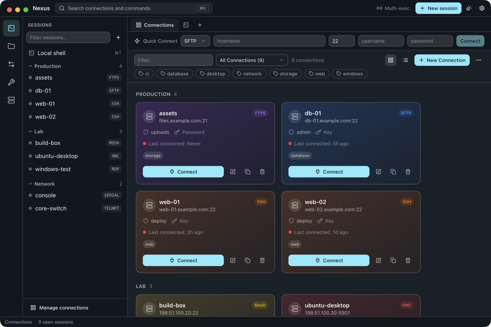

# Nexus

A remote-session manager for macOS. SSH, SFTP, FTP, RDP, VNC, Mosh, Telnet and serial connections live in one window, with a terminal and a file browser side by side.

<!-- Screenshot: add docs/screenshot.png and uncomment the line below -->
<!--  -->

## Features

**Connections**

- SSH and SFTP, FTP and FTPS, Mosh, Telnet, serial, a local shell, RDP and VNC.
- Saved connections with groups, tags and a health dot that shows whether each host is reachable.
- Passwords and key passphrases encrypted with the macOS keychain (Electron `safeStorage`), never stored in plain text.
- Import from `~/.ssh/config`, including jump hosts.
- Sync saved connections between Macs through a folder you choose, such as iCloud Drive or Dropbox. Nexus reads and writes one file there and talks to no sync service itself.

**Terminal and files**

- xterm.js terminal next to a remote file browser that follows the terminal's current directory.
- Split a terminal into up to four panes, type into every open terminal at once, and record keystrokes as replayable macros.
- Highlight rules that colour matching output, such as errors or IP addresses, without changing it.
- Edit a remote file in your default editor. Nexus downloads it, watches for saves and uploads each one.
- Transfer queue, drag and drop in both directions, and recursive text search across a server.
- Port forwarding, and X11 forwarding to XQuartz so remote GUI apps open as Mac windows.
- Optional AI command suggestions from an OpenAI-compatible endpoint, using your own key. Off until you turn it on.

**Built-in tools**

- Network scanner and port scanner.
- File diff and folder compare.
- Crontab editor for this Mac or a remote server, with plain-English schedules and next run times.
- Homebrew manager for installing and updating packages.
- One-click local servers: HTTP, SFTP, TFTP and iperf.

## Install

Download the latest `.dmg` from [Releases](https://github.com/Tendulkarx/nexus/releases), open it and drag Nexus to Applications. Builds are for Apple silicon Macs.

Releases are not yet signed with an Apple Developer ID, so macOS blocks the first launch. Open **System Settings › Privacy & Security** and click **Open Anyway**.

Some features use tools you install separately:

| Feature        | Needs                              |
| -------------- | ---------------------------------- |
| Mosh           | `brew install mosh`                |
| X11 forwarding | [XQuartz](https://www.xquartz.org) |

## Build from source

Requires macOS and Node.js 20 or later.

```bash
npm install
npm run dev          # run with hot reload
npm run build:mac    # build the .dmg and .zip into dist/
```

The RDP viewer is a native add-on, written in Objective-C++, that embeds the remote desktop directly in the window. Nexus runs without it. To build it:

```bash
npm run build:native
```

Before sending a change, run the checks:

```bash
npm run type-check && npm run lint && npm test
```

## How it is built

Electron, React 19, TypeScript and Tailwind, bundled with electron-vite. `ssh2` handles SSH and SFTP, `basic-ftp` handles FTP, `node-pty` runs local shells, and noVNC draws VNC sessions.

- `main/` is the Electron main process. Handlers in `main/handlers/` stay thin and pass work to services in `main/services/`, one per feature.
- `renderer/` is the React UI.
- `renderer/shared/ipc-contract.ts` defines every message between the two, so both sides share one set of types.
- `renderer/preload.ts` is the only renderer file that touches Electron APIs.

Releases are automated with release-please: merging the release pull request builds, tags and publishes a new version. Pull request titles follow Conventional Commits, which drive the version number and the changelog.

## Licence

Not yet chosen. Until a licence is added, all rights are reserved.
